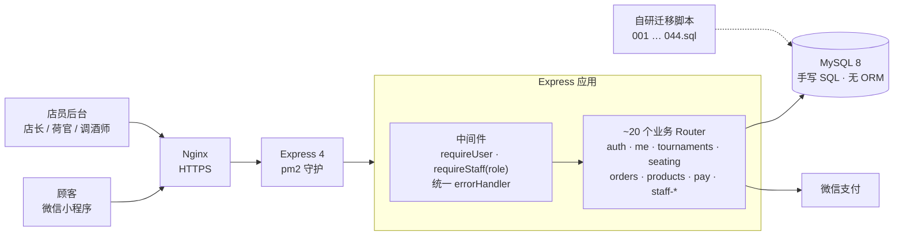
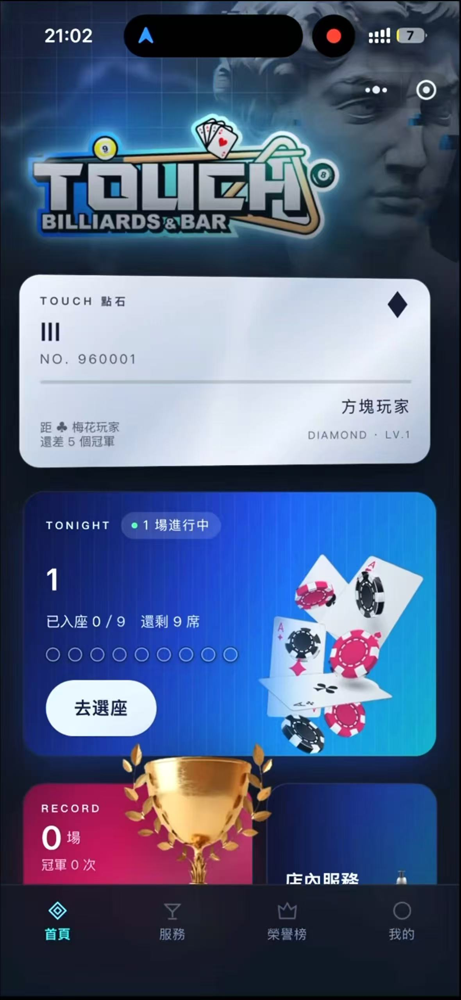
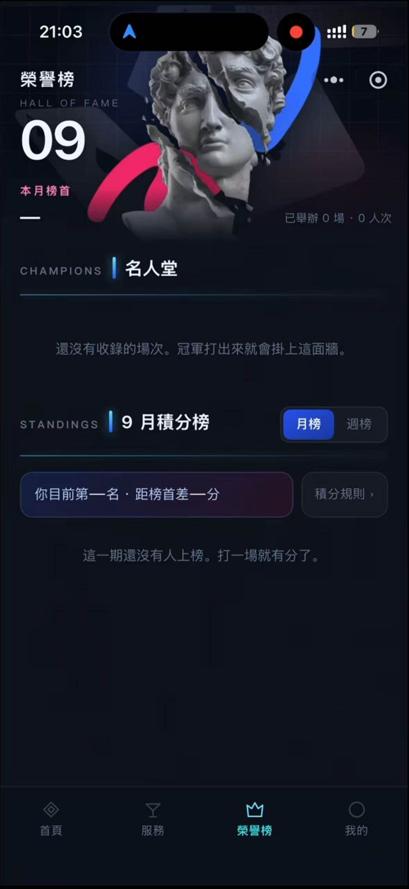
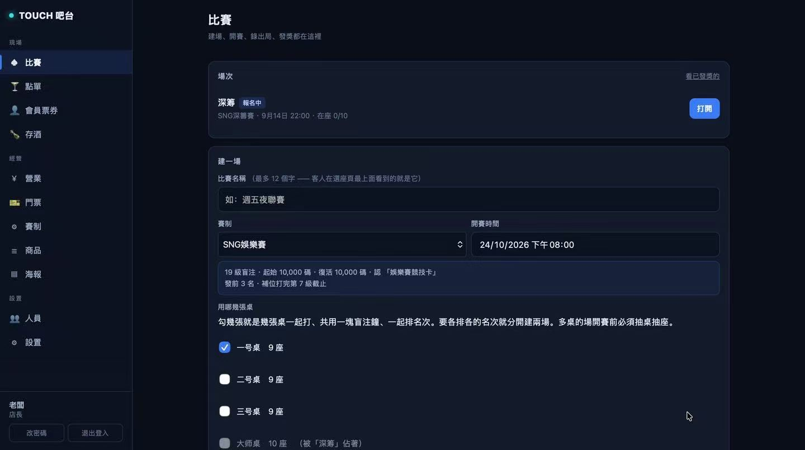

# 门店会员与赛事管理 · 微信小程序

> **A production WeChat Mini Program for a billiards bar** — membership, tournaments, seating, leaderboards, ordering and WeChat Pay. Designed, built and shipped solo.
>
> ⚠️ 本仓库为作品展示，客户项目源码不公开。截图已脱敏。

## 项目概览

| | |
| --- | --- |
| **客户** | 广州一家桌球酒吧（合同制项目，已上线运营） |
| **时间** | 2026.09 |
| **我的角色** | 独立全栈：需求调研 → UI 设计 → 可交互原型 → 前后端开发 → 部署上线 |
| **前端** | 微信原生小程序（WXML / WXSS / JS） |
| **后端** | Node.js 20 · Express 4 · MySQL 8（mysql2 连接池） |
| **鉴权** | JWT · bcryptjs |
| **部署** | 腾讯云轻量服务器 · Ubuntu 22.04 · pm2 · Nginx · SSL · ICP 备案 |
| **支付** | 微信支付 |

## 系统架构

## 功能模块

| 模块 | 内容 |
| --- | --- |
| 会员 | 五档会员等级、会员卡（3D 倾斜 + 虹彩扫光）、推荐有礼 |
| 赛事 | 赛制模板（级别表、复活规则、发奖）、建场快照、后端计时（开始 / 暂停 / 下一级） |
| 选座 | 多桌抽桌 → 抽座 → 开局 → 并桌 → 收场，全场统一排名 |
| 荣誉榜 | 名人堂、周榜 / 月榜（积分流水驱动，带涨跌） |
| 服务 | 点单、购物车、订单状态、微信支付、存酒记录 |
| 后台 | 店长 / 荷官 / 调酒师三级权限 |

## 技术亮点

### 1. 不用 ORM 的数据层
`db.js` 只封装 `query / queryOne / execute / transaction` 四个函数，业务里直接写 SQL —— 每条查询都清楚、可控、好调优。

### 2. 自研编号式迁移
`sql/migrate.js` + `001_users.sql … 044_*.sql`，按文件名顺序执行并记录版本，**重复运行自动跳过**，开发 / 生产环境结构始终一致。累计 44 次表结构迁移。

### 3. 积分流水表代替排名快照
积分每场写一条流水，周榜 / 月榜和涨跌箭头都靠**按时间截断聚合**算出，不需要存储排名快照。

### 4. 赛制快照
建场时把赛制模板拷贝一份进场次，之后修改模板**不影响已建场次**，避免进行中的比赛被改规则。

### 5. 状态流转有校验
抽桌 / 抽座 / 开局 / 并桌 / 收场每一步都在后端校验前置条件（如每桌至少 6 人、桌子同时只属于一场未收场比赛），防止误操作。

### 6. 先验证再迁移
先用单文件 HTML 做全链路可点原型给客户确认；迁移前做 **CSS 真机体检页**，在 iPhone 上逐项验证 mask、backdrop-filter、3D 翻转等十余项特性，再把原型搬进小程序。

## 截图

| 首页 | 荣誉榜 |
| --- | --- |
|  |  |

**店员 Web 后台**（吧台端）：建场、选赛制、勾选牌桌，开赛、录出局、发奖都在这里

---

作者：薛李锐 (Leo) · lxue5947@gmail.com · [GitHub 主页](https://github.com/lxue5947-sudo)
